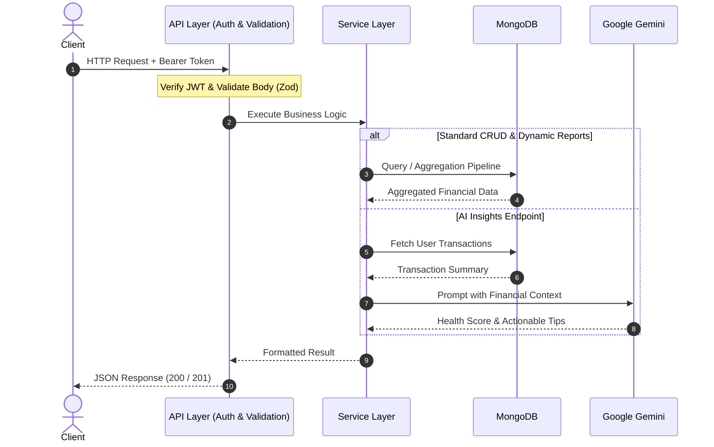
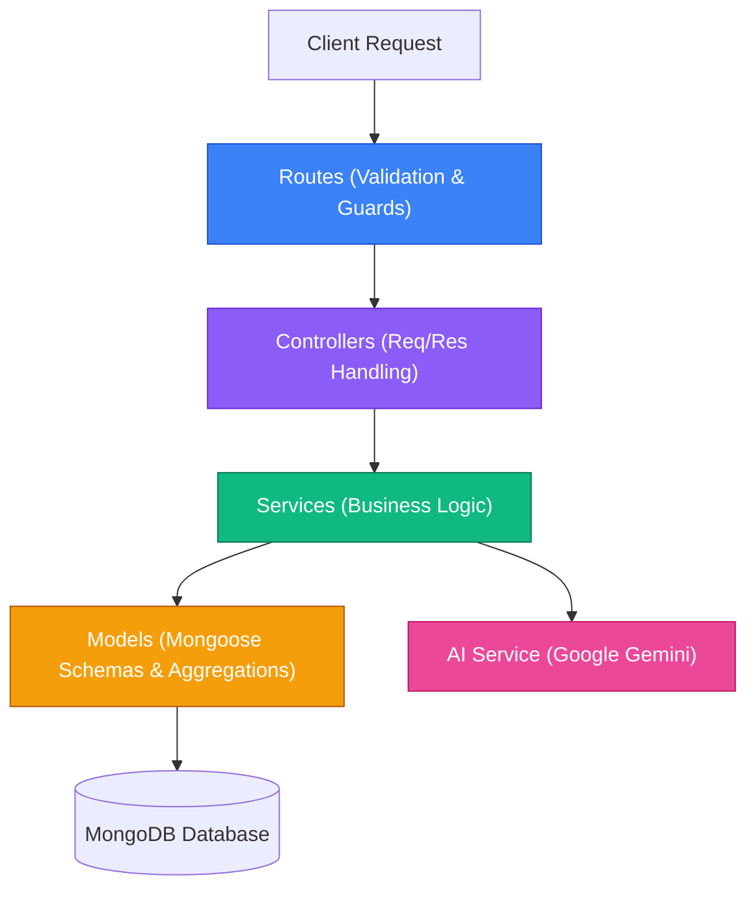

# Expense Tracker API

A production-ready, highly structured RESTful API built with **Node.js**, **Express 5**, **TypeScript**, and **MongoDB**. Features dynamic on-the-fly financial reporting, AI-powered spending insights via **Google Gemini**, comprehensive **Swagger / OpenAPI** documentation, and enforced database architectural boundaries.

---

## Key Features

- **Authentication & Security**: JWT-based authentication with bcrypt password hashing, `helmet` security headers, and strict CORS policies.
- **Transaction Management**: Full CRUD operations for income and expense transactions with date, category, and type filtering.
- **Dynamic Reporting (No Stale Data)**: High-performance MongoDB aggregation pipelines computing summaries, category distributions, and daily cash flow trends on the fly.
- **AI Financial Insights**: Intelligent financial health scoring, spending clues, and actionable savings advice powered by **Google Gemini** (`gemini-3.8-flash`).
- **Interactive Swagger Docs**: Live API testing and OpenAPI 3.0 documentation served at `/api-docs`.
- **Architectural Boundary Enforcement**: Automated CI script enforcing clean separation of concerns (only services interact with database models).
- **100% Test Coverage**: Comprehensive integration and unit testing suite powered by **Vitest** and **Supertest** (63+ tests).

---

## Request & Response Lifecycle

The diagram below illustrates the end-to-end flow of an authenticated request through the system:



---

## Architectural Boundaries

To prevent tight coupling and maintain clean separation of concerns, this project strictly enforces layered architecture via automated tests (`tests/architecture.test.ts`):



- **Controllers** are never permitted to import or query database models directly.
- **Services** are the sole layer permitted to interface with database models.
- **Direct `mongoose` imports** are restricted exclusively to `src/models/` and `src/config/db.ts`.

---

## API Reference

Interactive documentation is available at **`/api-docs`**. Below is a summary of all available routes:

### 1. Authentication (`/api/auth`)
| Method | Endpoint | Description | Auth Required |
| :--- | :--- | :--- | :---: |
| `POST` | `/api/auth/register` | Register a new user | No |
| `POST` | `/api/auth/login` | Authenticate and obtain JWT token | No |

### 2. Transactions (`/api/transactions`)
| Method | Endpoint | Description | Auth Required |
| :--- | :--- | :--- | :---: |
| `GET` | `/api/transactions` | List transactions (supports `type`, `minDate`, `maxDate` filters) | Yes |
| `POST` | `/api/transactions` | Create an income or expense transaction | Yes |
| `GET` | `/api/transactions/:id` | Get single transaction details | Yes |
| `PATCH` | `/api/transactions/:id` | Update transaction fields | Yes |
| `DELETE` | `/api/transactions/:id` | Delete a transaction | Yes |

### 3. Reports & Analytics (`/api/reports`)
| Method | Endpoint | Description | Auth Required |
| :--- | :--- | :--- | :---: |
| `GET` | `/api/reports/summary` | Financial overview (`totalIncome`, `totalExpense`, `netSavings`, `savingsRate`, breakdown) | Yes |
| `GET` | `/api/reports/trends` | Daily cash flow trends (`filterBy=7`, `30`, or `365`) | Yes |
| `GET` | `/api/reports/categories` | Spending distribution across all categories with percentages | Yes |
| `GET` | `/api/reports/breakdown` | Metrics for a single category (`?category=Food`) | Yes |
| `GET` | `/api/reports/insights` | AI-generated financial clues, health score, and saving tips | Yes |

### 4. Health & Docs
| Method | Endpoint | Description | Auth Required |
| :--- | :--- | :--- | :---: |
| `GET` | `/health` | Server uptime and health status | No |
| `GET` | `/api-docs` | Interactive Swagger UI documentation | No |

---

## How AI Financial Insights Work

The `/api/reports/insights` endpoint pairs on-the-fly MongoDB aggregation metrics with Google Gemini (`gemini-3.8-flash`) to deliver structured, personalized financial advice.

### 1. Dynamic Metric Aggregation
Before contacting the AI model, the system executes an aggregation pipeline via `reportService.getSummary()` to calculate real-time financial metrics directly from the user's recorded transactions:
- **Total Income & Total Expense**: Aggregated across all non-deleted user transactions.
- **Net Savings & Savings Rate (%)**: Calculated ratio of surplus to income.
- **Transaction Count Guard**: If no transactions exist, returns `400 Bad Request` to avoid generating hallucinations from empty data.
- **Category Spending Distribution**: Itemized spending totals and percentage share per category.

### 2. Contextual Prompting & Native JSON Enforcement
The calculated summary is formatted and forwarded to `aiService.getAIInsights()`. The service prompts Google Gemini as an expert personal financial advisor using native JSON mode (`responseMimeType: "application/json"` via `@google/genai`):

- **Health Score**: A calculated 1-100 rating based on savings rate and spending balance.
- **Summary Assessment**: A 2-sentence executive summary of financial health.
- **Spending Clues**: Key observations highlighting spending patterns and anomalies.
- **Actionable Tips**: Realistic, high-impact suggestions to reduce expense leaks.
- **Potential Monthly Savings**: Estimated numerical savings achievable by following the recommendations.

### 3. Example Response Payload

```json
{
  "success": true,
  "message": "AI Insight generated",
  "data": {
    "healthScore": 82,
    "summaryAssessment": "Healthy savings rate with consistent income surplus. Food and entertainment represent the largest discretionary spending categories.",
    "spendingClues": [
      "Dining and food delivery account for 38% of all monthly outflow.",
      "Savings rate is currently 26%, exceeding the recommended 20% baseline."
    ],
    "actionableTips": [
      "Allocate a weekly grocery meal-prep budget to reduce takeout by $150.",
      "Audit recurring monthly digital subscriptions for redundant services.",
      "Direct 5% of net income into an emergency fund buffer."
    ],
    "potentialMonthlySavings": 220
  }
}
```

---

## Getting Started

### Prerequisites
- [Node.js](https://nodejs.org/) (v18 or higher recommended)
- [MongoDB](https://www.mongodb.com/) (Local instance or MongoDB Atlas URI)
- [Google AI Studio API Key](https://aistudio.google.com/) (Free)

### 1. Clone the repository
```bash
git clone https://github.com/silasade/expense-tracker-api.git
cd expense-tracker-api
```

### 2. Install dependencies
```bash
npm install
```

### 3. Configure environment variables
Copy the example environment file and fill in your credentials:
```bash
cp .env.example .env
```
Edit `.env`:
```env
PORT=5000
MONGO_URI=mongodb://localhost:27017/expense-tracker
JWT_SECRET=your_super_secret_jwt_key
GEMINI_API_KEY=your_google_gemini_api_key
```

### 4. Start the application
```bash
# Development mode (with live reload via tsx)
npm run dev

# Production build & run
npm run build
npm start
```

---

## Interactive API Documentation (Swagger)

Once the application is running, open your browser and navigate to:
```text
http://localhost:<PORT>/api-docs
```
*(For example, `http://localhost:5111/api-docs` or `http://localhost:5000/api-docs` depending on your configured `PORT`).*

### How to Authenticate & Test Protected Routes in Swagger:
1. Under the **Auth** section, expand `POST /api/auth/login` (or `POST /api/auth/register`) and click **Try it out**.
2. Provide your credentials and click **Execute**.
3. Copy the `token` string from the JSON response body.
4. Scroll to the top right of the Swagger UI and click the green **Authorize** padlock button.
5. Paste your token into the **Value** field and click **Authorize**, then **Close**.
6. All protected routes across **Transactions**, **Reports**, and **AI Insights** can now be executed directly in the browser.

---

## Testing

The test suite runs with **Vitest** and validates unit logic, integration routes, middleware, and architecture boundaries:

```bash
# Run all test suites
npm test

# Run tests in watch mode
npm run test:watch

# Enforce database boundary checks independently
npm run check:db-boundary
```

---

## License
This project is open-source under the [ISC License](LICENSE).
